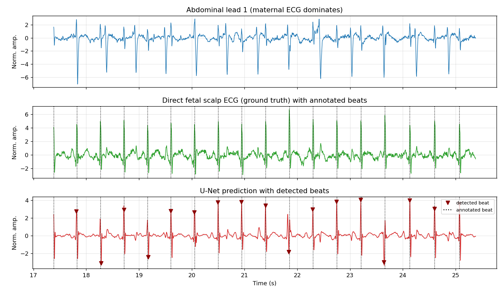
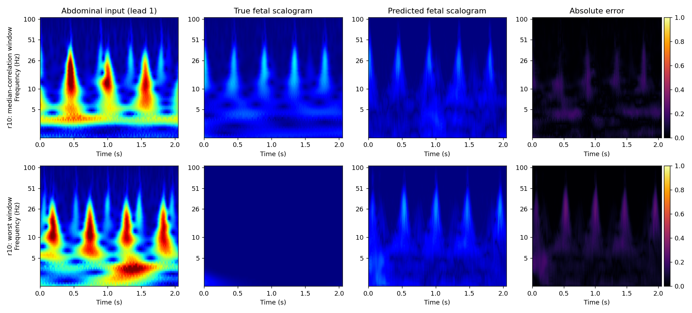
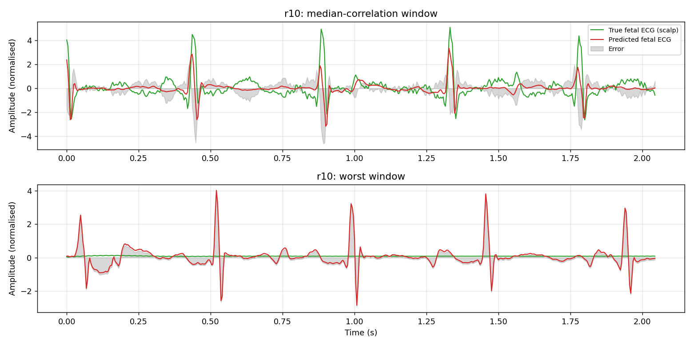

# Fetal ECG Extraction with Scalograms and a U-Net

[](https://github.com/OWNER/REPO/actions/workflows/ci.yml)


A computer-vision approach to a signal-processing problem: **recover the faint fetal ECG from
electrodes on the mother's abdomen** by turning the 1-D recordings into 2-D wavelet images
(*scalograms*) and translating them, image-to-image, with a **U-Net**.



*Held-out subject r10 (never seen in training). Top: one abdominal lead, where the maternal ECG
dominates. Middle: the direct fetal scalp ECG used as ground truth. Bottom: the fetal ECG the
network reconstructs from the four abdominal leads, with detected beats (▼) and expert annotations (dotted).*

---

## Why this problem is hard

The fetal heart signal on the abdomen is much weaker than the mother's, overlaps it in time and
frequency, and is buried in muscle noise. Classical tools (adaptive filtering, ICA, wavelet
denoising) work on the 1-D waveform, where the two sources are hard to tell apart. In a
**time–frequency image** they look different: the mother's beats are slower and stronger, the
fetus's faster and narrower. That is a pattern a CNN can learn.

## How it works

```mermaid
flowchart LR
    A["4 abdominal ECG leads<br/>(EDF, 1 kHz)"] --> B["Band-pass 2–100 Hz<br/>resample 250 Hz · z-score"]
    B --> C["Continuous Wavelet Transform<br/>complex Morlet, 64 scales"]
    C --> D["8-channel image 64×512<br/>log-magnitude + phase per lead"]
    D --> E["U-Net<br/>encoder · decoder · skip connections"]
    E --> F["Fetal scalogram<br/>real + imaginary part"]
    F --> G["Hann overlap-add<br/>+ inverse CWT"]
    G --> H["Fetal ECG waveform"]
    H --> I["R-peak detection<br/>→ fetal heart rate"]
```



| Step | What happens | Code |
|---|---|---|
| 1. Data | 5 labouring women, 4 abdominal leads + a direct fetal scalp lead (ground truth), 1 kHz | [`fecg/data/`](src/fecg/data) |
| 2. Pre-processing | zero-phase band-pass, anti-aliased resampling to 250 Hz, per-channel z-score | [`preprocess.py`](src/fecg/data/preprocess.py) |
| 3. Scalogram | CWT per lead → **magnitude** (energy) and **phase** (timing): 4 × 2 = **8 input channels** | [`transforms.py`](src/fecg/transforms.py) |
| 4. U-Net | encoder compresses context, decoder rebuilds a clean image, **skip connections** keep the fine detail of the narrow fetal QRS | [`models/unet.py`](src/fecg/models/unet.py) |
| 5. Output | fetal scalogram (real + imaginary part), blended over overlapping windows | [`inference.py`](src/fecg/inference.py) |
| 6. Back to 1-D | inverse CWT gives the fetal ECG waveform; a QRS detector finds the beats | [`beats.py`](src/fecg/beats.py) |

Details and design decisions: [docs/METHODOLOGY.md](docs/METHODOLOGY.md).

---

## Results

Everything below is measured on subjects **the network never saw**. The model is trained on three
subjects, the next one picks the best epoch, and the remaining one is the test subject. Because five
subjects are few, results are given both for one fixed split and as **leave-one-subject-out
cross-validation** (every subject is the test subject once).

### Cross-validation over all 5 subjects (headline result)

| Test subject | Waveform correlation | Median 2 s correlation | SNR gain | Beat F1, U-Net | Beat F1, best raw abdominal lead |
|---|---|---|---|---|---|
| r01 | 0.886 | 0.933 | +6.18 dB | **1.000** | 0.390 |
| r04 | 0.491 | 0.543 | +1.18 dB | **0.927** | 0.187 |
| r07 | 0.603 | 0.724 | +1.94 dB | **0.989** | 0.162 |
| r08 | 0.904 | 0.953 | +6.57 dB | **0.998** | 0.554 |
| r10 | 0.507 | 0.554 | +1.28 dB | **0.941** | 0.159 |
| **mean ± std** | **0.678 ± 0.181** | **0.741 ± 0.177** | **+3.43 ± 2.42 dB** | **0.971 ± 0.031** | 0.290 ± 0.157 |

Beat detection (±50 ms of the expert annotation), mean over the 5 subjects: **precision 0.978,
recall 0.964, F1 0.971**. The same detector run on the true scalp ECG scores F1 0.997, so the
detector and the annotation alignment are sound; the best *raw* abdominal lead mostly finds maternal
beats (F1 0.29). Scalogram error on magnitude images scaled to [0, 1]: MSE 0.0144, RMSE 0.1113,
MAE 0.0544. Full per-fold output: [results/cv/](results/cv).

### One fixed split: train r01 r04 r07 · select r08 · test r10

| Domain | Metric | Value |
|---|---|---|
| Scalogram | MSE / RMSE / MAE | 0.0100 / 0.1001 / 0.0523 |
| Waveform | Pearson correlation (whole record) | 0.516 |
| Waveform | Median correlation over 2 s windows | 0.544 |
| Waveform | SNR, best raw abdominal lead → U-Net | 0.04 → 1.36 dB (gain **+1.32 dB**) |
| Beats | Precision / Recall / **F1** (U-Net) | 0.942 / 0.921 / **0.931** |
| Beats | F1, best raw abdominal lead (baseline) | 0.159 |
| Beats | F1, detector on the true scalp ECG (sanity check) | 0.997 |

r10 and r04 are the two hardest subjects for waveform correlation (see the cross-validation table for
the spread). Reproduce with the commands below; raw metrics are in [results/metrics.json](results/metrics.json).

### What the network sees and produces



*Columns: abdominal input (lead 1), true fetal scalogram, predicted fetal scalogram, absolute error.
Rows: the window with the median correlation and the window with the worst correlation, picked
automatically (not by hand). The maternal energy that dominates the input is gone from the output.*



*Predicted vs. true fetal ECG in the same two windows. In the "worst" window the scalp reference is
almost flat (the electrode lost signal), so the correlation is meaningless there, while the network
still outputs regular beats. Amplitude and P/T-wave detail are only partly recovered; QRS timing is
recovered best.*

### Comparison with the project report

The report presents these numbers; its split, window length and metric definitions are not stated.

| | Report | This repo, unseen subjects (CV mean) | This repo, random window split* |
|---|---|---|---|
| Correlation | 0.997 | 0.678 | 0.975 |
| Scalogram MSE / RMSE / MAE | 0.0065 / 0.0806 / 0.0610 | 0.0144 / 0.1113 / 0.0544 | 0.0007 / 0.0236 / 0.0146 |
| Beat precision / recall / F1 | 0.982 / 0.955 / 0.967 | 0.978 / 0.964 / 0.971 | not applicable |

\* [`scripts/random_split_baseline.py`](scripts/random_split_baseline.py): the baseline U-Net (7.8 M
parameters, 20 epochs, no augmentation) trained and tested on a random 80/10/10 split of the
overlapping windows. Neighbouring windows overlap by 75 % and come from the same five recordings, so
near-copies of every test window are in the training set; **this number is not a valid estimate for a
new patient** and is shown only to explain the gap. **On unseen subjects, beat detection matches the
figures in the report; waveform correlation does not, so the report's 0.997 should not be read as
subject-independent performance.**

### Ablations

All variants evaluated with the same leave-one-subject-out protocol; the configuration was chosen by the
*validation* subjects' correlation, not by test scores.

| Variant (5-fold CV) | Beat F1 | Waveform correlation |
|---|---|---|
| Baseline: U-Net 7.8 M, 20 epochs, no augmentation or regularisation | 0.805 ± 0.243 | 0.656 ± 0.219 |
| + augmentation (lead shuffle, gain jitter, polarity flip) | 0.959 ± 0.048 | 0.653 ± 0.198 |
| **+ correlation loss, dropout 0.2, weight decay 0.01, U-Net 1.9 M, 30 epochs (default)** | **0.971 ± 0.031** | **0.678 ± 0.181** |

Without regularisation the network memorises the three training subjects and misses the beats of the
hard ones (r04: F1 0.41, r10: 0.63). Augmentation fixes most of that. Details:
[results/ablations/](results/ablations).

| Pre-processing band (test r10, same hyper-parameters) | Correlation | SNR gain | Beat F1 | Transform ceiling† |
|---|---|---|---|---|
| Report: 0.5–100 Hz | 0.195 | +0.16 dB | 0.901 | 0.715 |
| **This repo: 2–100 Hz** | **0.516** | **+1.32 dB** | **0.931** | **0.993** |

† correlation obtained by inverting the *true* fetal scalogram: the best any scalogram model could do.

### Finding: low-frequency drift decides the waveform metric

The scalp reference carries slow baseline drift: across the five subjects **25–82 % (median 60 %) of
its variance lies below 2 Hz**. That is electrode drift, not heartbeat, and it cannot be predicted from
the abdomen. With the report's 0.5 Hz high-pass the correlation metric mostly measures the drift
(0.195 on r10). High-passing at 2 Hz, safely below the 2.1–2.5 Hz fetal heart-rate fundamental,
fixes this (0.516), and also makes the transform lossless in the band (ceiling 0.715 → 0.993).
The old setting is one command away: `--set data.bandpass=[0.5,100] cwt.fmin=1.0`.

### Limitations

* **Five subjects, 25 minutes of data.** Cross-subject variance is large (waveform correlation 0.49–0.90);
  this is a research prototype, not a clinical validation.
* The target is a **scalp lead** and the input are **abdominal leads**, so the network learns a lead-to-lead
  translation: QRS timing is recovered well, P/T-wave morphology and amplitude only partly.
* Errors concentrate where a maternal QRS coincides with a fetal one, and where the scalp reference
  itself is corrupted.
* The beat detector is a simple threshold-based one; a stronger detector would change absolute scores
  for every signal, the ground truth included.

---

## Quick start

```bash
git clone https://github.com/OWNER/REPO.git && cd REPO
python -m venv .venv && source .venv/bin/activate        # Windows: .venv\Scripts\activate
pip install -e ".[dev]"                                   # installs PyTorch, PyWavelets, ...

python scripts/download_data.py        # 5 records from PhysioNet (~15 MB, checksum-verified)
python scripts/preprocess.py           # filter, resample, CWT scalograms  -> data/processed
python scripts/train.py                # train the U-Net                   -> checkpoints/
python scripts/evaluate.py             # test subject: metrics + figures   -> results/
python scripts/cross_validate.py       # optional: 5-fold leave-one-subject-out  -> results/cv
```

A trained checkpoint ([`checkpoints/unet_best.pt`](checkpoints), 7.8 MB) is included, so you can skip
training:

```bash
python scripts/download_data.py && python scripts/preprocess.py && python scripts/evaluate.py
```

**Run it on a recording** (any EDF with four abdominal leads; no fetal reference needed):

```bash
python scripts/predict.py --edf data/raw/r10.edf --checkpoint checkpoints/unet_best.pt
# -> results/predictions/r10_fetal_ecg.npy, r10_beats_s.csv, r10_prediction.png
# 620 fetal beats, median fetal heart rate 131.6 bpm
```

A GPU is used automatically if available (about 15 s per epoch on an RTX 4070 laptop GPU); the CPU also
works, only slower. For CUDA, install the matching PyTorch build from [pytorch.org](https://pytorch.org)
first. Run the tests with `pytest` (about 20 s, no dataset needed).

### Configuration

Everything is in [`configs/default.yaml`](configs/default.yaml); any value can be overridden from the
command line, for example:

```bash
python scripts/train.py --set train.epochs=10 model.base_channels=32 train.augment=false
python scripts/preprocess.py --set data.bandpass=[0.5,100] cwt.fmin=1.0 data.processed_dir=data/processed_report_band
```

| Section | Key options |
|---|---|
| `data` | band-pass, sampling rate, channel names, subject-wise `split` (train / val / test) |
| `cwt` | wavelet, number of scales (image height), frequency range, window length (image width), stride |
| `model` | base width, depth, dropout |
| `train` | epochs, batch size, learning rate, weight decay, loss weights, augmentation, mixed precision |

## Project structure

```
fetal-ecg-unet/
├── configs/default.yaml          all hyper-parameters
├── scripts/                      command-line entry points
│   ├── download_data.py          fetch + verify the PhysioNet records
│   ├── preprocess.py             filter, resample, CWT
│   ├── train.py                  train the U-Net
│   ├── evaluate.py               metrics + figures on the test subject
│   ├── cross_validate.py         leave-one-subject-out CV
│   ├── predict.py                run on any EDF recording
│   └── random_split_baseline.py  diagnostic: why random window splits mislead
├── src/fecg/
│   ├── data/                     EDF + annotation readers, download, preprocessing, Dataset
│   ├── models/unet.py            U-Net
│   ├── transforms.py             CWT scalograms and the inverse CWT
│   ├── losses.py                 scalogram + waveform + correlation loss
│   ├── engine.py                 training loop
│   ├── inference.py              sliding-window prediction, Hann overlap-add
│   ├── beats.py                  R-peak detection and beat scoring
│   ├── metrics.py                scalogram / waveform metrics
│   ├── evaluate.py  crossval.py  predict.py  visualize.py  utils.py
├── tests/                        25 tests incl. an end-to-end run on synthetic data
├── docs/METHODOLOGY.md           step-by-step method and design decisions
├── results/                      metrics, figures, cross-validation, ablations
├── checkpoints/                  released model + training history
└── .github/workflows/ci.yml      tests on every push
```

## Dataset

[PhysioNet Abdominal and Direct Fetal ECG Database](https://physionet.org/content/adfecgdb/1.0.0/)
(`adfecgdb`): five women in labour, 38–41 weeks of gestation, four abdominal leads plus a direct fetal
scalp ECG, 1 kHz, 16 bit, with expert fetal-QRS annotations. The data is not redistributed here;
`scripts/download_data.py` fetches it and verifies the published SHA-256 sums.

## References

* Jezewski J, Matonia A, Kupka T, Roj D, Czabanski R. *Determination of fetal heart rate from abdominal
  signals: evaluation of beat-to-beat accuracy in relation to the direct fetal electrocardiogram.*
  Biomedizinische Technik 57(5):383–394, 2012 (database).
* Goldberger AL et al. *PhysioBank, PhysioToolkit, and PhysioNet.* Circulation 101(23):e215–e220, 2000.
* Ronneberger O, Fischer P, Brox T. *U-Net: Convolutional Networks for Biomedical Image Segmentation.* MICCAI 2015.
* Torrence C, Compo GP. *A Practical Guide to Wavelet Analysis.* Bull. Am. Meteorol. Soc. 79(1):61–78, 1998.
* Related work discussed in the project report: Lin et al., *A novel deep learning model for fetal ECG
  signal extraction using convolutional autoencoder and attention mechanism*; Nguyen, *Fetal ECG
  extraction on time-frequency domain using conditional GAN*; Zhong & Zhao, *Fetal ECG extraction using
  short time Fourier transform and generative adversarial network*.

## Team

**Team B4**: Aakash, Darani Karthik, Mahizhan, Pavani Akshaya.

## License

[MIT](LICENSE). The dataset is distributed by PhysioNet under its own license.
